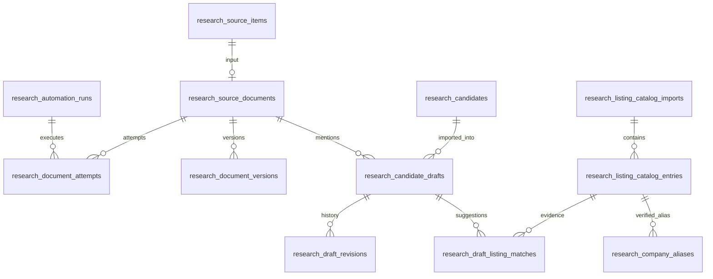

# UC-016 企業候補自動抽出の追加保存定義

2026-10-19。**追加Gate 3本人承認済み（2026-10-19）**。[ADR-0033](../adr/ADR-0033-research-candidate-automation.md)の詳細定義。[追加Gate 2](../product/megatrend-candidate-automation-spec.md)は本人承認済み。既存の[調査記録](data-model.md)と取得項目は保持する。

## 共通規約と関係

新規10テーブル。全PKは`id bigint unsigned auto`、FKは`bigint unsigned`・個別INDEX・削除RESTRICT。文字列はutf8mb4/utf8mb4_unicode_ci、ハッシュはUTF-8正規化後のSHA256の小文字hex（char64）。原表記とハッシュ前の値も保持し、衝突時に異なる原値を上書きしない。`created_at/updated_at`はtimestamp（版/履歴はcreated_atのみ）。複合UNIQUE/FK/INDEXの名前は64文字以内の短い明示名を指定し、Laravel自動命名による長さ超過を避ける。日時はUTC保存、本人確認日は既存DisplayTimeのローカル日付。新規の状態はvarcharでアプリ側の許可値を検証し、既存enumを変更しない。

JSON内のフィールドはスキーマ版とサイズを検証する。検索・一意性・関連付けに使うIDは列/FKに置き、JSON内のIDだけに依存しない。自己/循環参照のある資料ポインタは、親/版テーブル作成後の追加FKとして定義する。

## 1. research_automation_runs（後続処理の実行）

| 列 | 型・NULL/既定 | 意味 |
|---|---|---|
| trigger | varchar20、必須 | startup / manual / backfill |
| actor_id | bigint、NULL可 | 手動実行者users.id。自動時はNULL |
| started_at / finished_at | timestamp、終了のみNULL可 | 実行の時刻 |
| status | varchar20、既定running | running / completed / partial / failed / interrupted |
| counters | json、必須、4KB以内 | 処理済み/未解析/失敗/新下書き/基準線の件数。資料数と企業数を混同しない |
| error_code | varchar80、NULL可 | 固定エラー種別。外部本文を入れない |

INDEX: `(started_at,id)`。FK: actor_id→users。ロックを取得できなければ新しいrunやHTTP試行を作らず「実行中」と返す。runningのまま終了した過去runはロック失効後にinterruptedとし、完了件数を捏造しない。

## 2. research_source_documents（取得項目に対応する処理待ち資料）

| 列 | 型・NULL/既定 | 意味 |
|---|---|---|
| source_item_id | bigint、必須UNIQUE | research_source_items.id。source_key/URLは元項目から参照 |
| latest_feed_version_id / latest_content_version_id | bigint、NULL可 | 後述の同じdocumentに属する版へのFK。NEDOだけcontentを使う |
| last_seen_check_id | bigint、NULL可 | 一覧で最後に確認したresearch_source_checks.id |
| extraction_state | varchar24、既定pending | pending / extracted / no_company / unsupported / failed。失敗しても前の成功版を保持 |
| last_attempt_at / last_success_at / next_attempt_at | timestamp、NULL可 | 本文の試行/成功/次回可能時刻。フィードの時刻とは別 |
| extracted_version_id | bigint、NULL可 | 最後に下書きへ反映した有効版へのFK |
| lock_version | int unsigned、既定1 | HTTP後の古い結果で新しい版を上書きしないため |

INDEX: `(extraction_state,next_attempt_at,id)`, last_seen_check_id、各版FK。ポインタ更新時に同一document/phaseであることを必ず検証する。FDA/H02の有効版はfeed、NEDOはcontent。前の成功版だけで「今回は解析済み」と表示しない。

## 3. research_document_attempts（資料1件の処理試行）

| 列 | 型・NULL/既定 | 意味 |
|---|---|---|
| run_id / document_id | bigint、必須 | 実行/資料のFK |
| phase | varchar20、必須 | feed_extract / detail_fetch |
| started_at / finished_at | timestamp、終了のみNULL可 | 外部アクセス間隔に使う。完了不明時は開始時刻 |
| status | varchar24、既定running | running / extracted / unchanged / no_company / unsupported / failed / interrupted |
| input_version_id / output_version_id | bigint、NULL可 | 入出力の資料版。実行時に同じdocumentであることを検証 |
| http_status / response_bytes | smallint unsigned / int unsigned、NULL可 | HTTPなしの場合は両方NULL |
| error_code | varchar80、NULL可 | 構造変化・サイズ・時間・PDFのみ等の固定コード |

INDEX: `(document_id,started_at,id)`, run_id、版FK。待機中に予算が尽きてHTTP未実行ならHTTP試行を作らない。失敗も完了時刻+24時間（秒精度の余裕1秒）を次回可能時刻とする。中断で完了が不明なら回復を検知した時刻を保守的な基準にし、実HTTPの完了と成功を捏造しない。NEDOホスト間隔はこの表と既存一覧試行の遅い完了/開始時刻を共用する。

## 4. research_document_versions（必要情報の追記版）

| 列 | 型・NULL/既定 | 意味 |
|---|---|---|
| document_id | bigint、必須 | 資料FK |
| phase / version_no | varchar20 / int unsigned、必須 | feed / contentと資料内の通番 |
| parent_feed_version_id | bigint、NULL可 | NEDO本文版の根拠となったfeed版。同じ資料に限定 |
| observed_check_id / attempt_id | bigint、NULL可 | feedは既存source_check、contentはdocument_attemptへのFK |
| payload / payload_hash | json / char64、必須 | 下記の必要情報のみ。本文全体は保存しない |
| parser_version / rule_version | varchar40、必須 | 解析・分類の版。分類設定はコードレビューで管理 |
| observed_at | timestamp、必須 | 実取得/観察時刻。元発表日と別 |

UNIQUE: `(document_id,version_no)`。INDEX: `(document_id,phase,version_no)`、各FK。追記のみ。直前版のpayload/hash/parser/ruleと等しければ追記しない。過去hashとの一意制約は置かずA→B→Aを記録できる。

payload v1の必須枠: `schema_version=1`, `source_url`, `source_title`, `publisher`, `published_at`, `announced_on`, `updated_on`, `source_fields`, `mentions`, `extraction_result`。不明な日付はNULL。source_fieldsは既存FDA6キー/NEDO3キー/H02の必要metadata。mentionsは原法人名・厳密な表記キー・役割配列・根拠URL/見出し/短い根拠箇所・テーマ配列/分類根拠を持つ。

上限: payload全体128KiB、1資料50法人、原法人名255文字、役割255文字、テーマ100文字、説明/根拠各2000文字、全根拠合計16KiB、URL2048文字。超過/必須枠破損は失敗として前の成功版を保持し、切り捨てて候補0成功にしない。問い合わせ/委員/本文全体を保存しない。FDA決定日はsource_fieldsにだけ置き、announced_on/published_atを補わない。

## 5. research_candidate_drafts（資料×言及法人の未確認候補）

| 列 | 型・NULL/既定 | 意味 |
|---|---|---|
| document_id / latest_version_id / current_document_version_id | bigint、必須 | 資料/この法人を最後に抽出した版/現在の資料版（法人が消えた場合も更新） |
| mention_key / raw_name | char64 / varchar255、必須 | 原法人名の厳密な正規化値のハッシュと原表記。正規化はNFKC・連続空白整理のみ |
| normalized_name | varchar255、必須 | ハッシュ前の値。法人格/句読点を削除しない |
| extracted_fields | json、必須、16KiB以内 | roles/themes/分類理由/資料由来の要点。検索用テーマ絞り込みはJSONの厳密一致、投資スコアなし |
| human_overrides | json、NULL可、16KiB以内 | 本人が訂正したフィールドだけ。取得値と別に表示 |
| disposition / reason | varchar20、既定unreviewed / varchar2000、NULL可 | unreviewed / reviewing / on_hold / rejected / out_of_scope / imported。保留/見送り/対象外は理由必須 |
| presence | varchar20、既定present | present / removed。最新資料から消えた事実。dispositionを戻さない |
| first_detected_at / last_observed_at | timestamp、必須 | 初検出/最終観察。既存資料後処理は新機能導入後の検出時刻 |
| discovery_kind | varchar20、必須 | new / baseline / backfill。初回/過去分を新着数から除く |
| reviewed_version_id / reviewed_on / reviewed_by | bigint / date / bigint、NULL可 | 本人が確認した資料版・実日付・users FK |
| imported_candidate_id / imported_link_id / imported_version_id | bigint、NULL可 | research_candidates / research_discovery_links / document_versionsへのFK |
| lock_version | int unsigned、既定1 | 自動変更/本人変更どちらでも増やす |
| match_generation / match_input_hash | int unsigned、既定0 / char64、NULL可 | 上場照合結果の世代と入力（資料版・マスタ版・有効別名/規則）のハッシュ |

UNIQUE: `(document_id,mention_key)`。INDEX: `(disposition,first_detected_at,id)`, `(presence,disposition)`, normalized_name、全FK。同じ版の再抽出はlast_observedだけを更新し履歴/版競合を不要に増やさない。役割の追加・原資料の意味的変更は版を上げ、本人が確認した版を更新しない。

異なる資料の同名を一意制約で統合しない。資料一覧は別に保持し、企業集計は現在の上場候補の同一発行体/本人が確認した別名対応で束ねる。曖昧なら「仮の候補数」。同じ元発表と判明した転載は既存eventへ関連付けて1件と数える。別々の下書きが同じ調査記録へ取り込まれる場合も、それぞれの根拠版/リンクを保持する。

## 6. research_draft_revisions（下書きの変更履歴）

| 列 | 型・NULL/既定 | 意味 |
|---|---|---|
| draft_id / lock_version | bigint / int unsigned、必須 | 下書きFKと版 |
| change_type | varchar32、必須 | extracted / source_changed / corrected / disposition_changed / restored / imported / source_removed |
| actor_id | bigint、NULL可 | users FK。自動変更はNULL |
| payload | json、必須、64KiB以内 | 抽出値/本人訂正/処理状態/確認版/取り込み先/上場候補根拠のスナップショット |
| created_at | timestamp、必須 | 追記時刻。updated_atなし |

UNIQUE: `(draft_id,lock_version)`、actor_id INDEX。追記のみ。主張の本人確認とは別の履歴である。64KiBを超える変更は失敗させ、履歴だけ省略して保存しない。

## 7. research_listing_catalog_imports（公式上場情報の取込試行/公開版）

| 列 | 型・NULL/既定 | 意味 |
|---|---|---|
| run_id | bigint、必須 | automation_run FK |
| catalog_key | varchar20、必須 | jpx_tse / sec_exchange |
| source_url | varchar2048、必須 | 設定で固定した公式配布URL |
| started_at / finished_at / published_at | timestamp、終了/公開のみNULL可 | 取込の時刻。公開は全件検証/保存後 |
| as_of_on | date、NULL可 | JPXの資料基準日。SEC不明時はNULL |
| status | varchar20、既定running | running / published / failed / blocked / interrupted |
| content_hash / row_count | char64、NULL可 / int unsigned、既定0 | 応答ダイジェスト/有効行数 |
| error_code | varchar80、NULL可 | 固定コード。UA未設定はblocked・HTTPなし |

INDEX: `(catalog_key,status,published_at,id)`、run_id。自動照合は最新の公開済み全体版だけを使い、さらに最新試行の失敗/鮮度切れを評価する。JPXの古い基準日への巻き戻り・必要行の構造破損・0行は公開しない。本文/Excelファイル全体をDBへ保存しない。

## 8. research_listing_catalog_entries（取込版ごとの銘柄行）

| 列 | 型・NULL/既定 | 意味 |
|---|---|---|
| import_id | bigint、必須 | 公開版/準備中版のFK |
| market / symbol_code | varchar8 / varchar20、必須 | jp / usと既存ResearchSymbolCodeで検証したコード |
| issuer_key | varchar80、必須 | SECはCIK、JPXは当該基準日の市場/コード/名称を識別するキー。日本コードだけで恒久的法人IDとしない |
| legal_name / normalized_name / name_hash | varchar255 / varchar255 / char64、必須 | 公式表記/検索用の厳密な正規化/ハッシュ |
| exchange / security_type | varchar80、必須 | 元の取引所/区分。欠測・対象外は区別する |
| reference_url | varchar2048、必須 | 公式配布元/発行体ページ。外部URLを自由に取得しない |

UNIQUE: `(import_id,market,symbol_code)`。INDEX: `(import_id,name_hash)`, `(import_id,issuer_key)`。名称同一をUNIQUEにしない。SECの同CIK複数ティッカーは同発行体候補、JP/US間の同一法人・親子関係は別名の本人確認がない限り統合しない。OTC/市場不明は本版の自動上場候補から除き「対象市場要確認」とし、非上場と断定しない。

## 9. research_company_aliases（本人確認のある別名/親会社対応）

| 列 | 型・NULL/既定 | 意味 |
|---|---|---|
| raw_name / normalized_name / name_hash | varchar255 / varchar255 / char64、必須 | 抽出名と厳密な表記キー |
| target_entry_id | bigint、必須 | 確認時のlisting_catalog_entryへのFK |
| relationship | varchar24、必須 | same_entity / subsidiary_of / brand_of。後2者を言及法人と同一法人として数えない |
| evidence_url / note | varchar2048 / varchar2000、必須 | 親子/別名関係の公式根拠。人の判断理由 |
| confirmed_on / confirmed_by / revoked_at | date / bigint / timestamp、取消のみNULL可 | 本人の日付/users FK、撤回時刻 |

INDEX: `(name_hash,revoked_at)`, target_entry_id, confirmed_by。自動作成しない。同じ表記に複数の有効対応があれば曖昧。対象の現在版に同じ発行体が見つからなければ古い別名を自動適用しない。訂正は旧対応を撤回し新しい行を追加し、監査へ記録する。

## 10. research_draft_listing_matches（下書きの上場先候補）

| 列 | 型・NULL/既定 | 意味 |
|---|---|---|
| draft_id / entry_id | bigint、必須 | 下書き/公開カタログ行FK |
| generation | int unsigned、必須 | 当該照合実行のdraft.match_generation |
| alias_id | bigint、NULL可 | 確認済み別名を用いた場合のFK |
| match_method | varchar24、必須 | exact_name / verified_alias。候補の根拠であり本人の上場確認ではない |
| reason | varchar2000、必須 | どの原表記/資料版/別名で一致したか |
| matched_at / superseded_at | timestamp、終了のみNULL可 | 候補の有効期間。訂正/新公開版で旧行を終了させる |

UNIQUE: `(draft_id,generation,entry_id,match_method)`。INDEX: `(draft_id,superseded_at)`と全FK。入力ハッシュが同じなら再生成しない。入力変更時はdraft行ロック下で世代を+1し、旧候補を終了して新世代を同じtransactionで追加する。別名の取消→再確認も新世代にし、旧根拠を上書きしない。複数候補、親子対応、マスタ欠測/古さを本人に示す。これを`research_entity_listings.confirmed_on`へ自動変換しない。

## 既存research_discovery_linksへの追加3列

| 追加列 | 型・既定 | 用途 |
|---|---|---|
| input_origin | varchar20、NOT NULL既定manual | manual / automatic。既存行を変換せず、入力由来を表示する正本にする |
| generated_summary | varchar2000、NULL | 資料由来の要点。既存summary（本人追記）と別表示 |
| source_document_version_id | bigint unsigned、NULL、INDEX/FK | 取り込み時の資料版。既存/手動行はNULL |

既存の`route_type=manual`は互換列として残し、新しい画面の由来判定はinput_originを使う。既存summary/checked_onの型や手動入力の必須条件は変えない。自動取り込みサービスだけはsummaryが空文字でもgenerated_summaryと根拠版が揃えば保存できる。人の追記がないことを明示し、自動文をsummaryへ複製しない。資料の要点を更新するときは新資料版を本人が選び、候補の版へ変更前後を追記する。

## 既存research_source_checksへの追加2列（一時的な抽出入力）

| 追加列 | 型・既定 | 用途 |
|---|---|---|
| automation_payload | json、NULL | 今回解析した項目配列（schema_version/各source_item_idと当該フィールド/基準線区分）。記事本文なし、8MiB/5万項目まで。取得時に1回書き込み、後続処理が終わったらNULLに戻す |
| automation_cursor | int unsigned、NULL | 次に処理する配列位置。入力保存時は0。既存チェックはNULLで自動入力を偽造しない |

取得時の解析済み配列を小さな一時入力として記録し、数千件の資料/版/下書きのINSERTを15秒の取得枠に足さない。後続コマンドは古い成功チェックのカーソルから200件/回を処理し、処理済み資料版/下書きとカーソルの更新を同じtransactionにする。完全な処理完了後だけpayload/cursorをNULLへ戻す。途中/障害時は残す。行順/入力は処理中に変更せず、別チェックへA→B→Aの観察順を保持する。未処理チェックを古い順に処理し、後の取得で古い一時入力を上書きしない。

一時入力が上限を超えた取得は一部だけ成功にせず、既存取得と同様に失敗として表示する。既存source_itemsが既にあるかどうかにかかわらず、今回の解析値を記録する。抽出無効時には新しい一時入力を作らず、保存済みの未処理分は消さない。新機能導入前のsource_itemsは既存の原情報から別途backfillし、新着へ数えない。資料の正式な版が保持するのは必要フィールドだけである。

## トランザクションと競合の契約

- 取得層は応答全体の解析成功後に、既存項目の新規保存と一時入力1件の記録を同じtransactionで実施。既存項目を更新しない。後続の200件処理はsource_check行ロック→document/draftの順に保存し、カーソル更新と一体化する。障害時は同じ入力位置から再開し、一部だけを処理済みにしない。
- NEDOはHTTP/解析を先に行い、保存時にdocumentの期待版を照合。同資料のfeed版が進んでいたら結果を採用せず再解析待ちにする。資料版/抽出の一部だけを成功にしない。
- 下書き更新のロック順はdocument→draft（ID昇順）→draft_revision→matches。人の取り込みもこの順で確認した後、既存event→entity→candidate（各ID順）→discovery_link→candidate_revisionを処理する。異なる手動経路とのdeadlockは有限回再試行し、版競合とは区別して扱う。
- 取り込みは期待するdraft.lock_version/資料版/公開マスタ版を比較し、元発表/法人/候補/発見経路/既存候補版/下書きの取り込み先/下書き版を1transactionで保存。同じdraftの並行/再送は行ロックと取り込み先FKで同じ結果に収束する。既存の共有eventへ新リンクを追加した場合の関連候補の版更新/再確認も維持する。
- 元資料訂正後の確認不足は、`current_document_version_id != reviewed_version_id`またはpresence=removedの未確認から導く。本人訂正/見送りを保持する。監視確定では従来のcandidate版に加え、関連下書きの最新資料版と現在マスタ版/別名の取消/基準CSV・保有を再照合する。取り込み済み本文は自動更新しない。再確認では本人が差分/掲載消失を確認し、必要な既存の主張/元発表の訂正・再確認を行う。再確認操作をcandidateの版とdraftの確認版へ同じtransactionで記録する。imported_version_idは初回取り込みの履歴であり、差が残るだけで再確認後も永久に監視拒否する条件にはしない。
- 取り込み時点では元発表/主張/上場主体/反証は未確認。未知テーマは「未分類」、分類根拠なしを明示する。自動入力されたテーマ/役割も、監視確定前に本人が確認する。既存の1項目/1リンクのFKは互換情報として残し、複数企業の対応はdraft側を正本とする。自動抽出だけではsource_itemの本人状態をrecordedへ変えない。

## 移行・停止と戻し方

1. Gate 3/4承認後、追加テーブルとnullable/既定値付き5列だけを作成する。既存migrationは編集しない。FKの作成順を分け、既存データの破壊/enum変更/自動変換を含めない。
2. 新処理は停止設定で導入し、旧手動記録・source_items一覧・UC-012回帰を先に確認。旧summaryの強制移行や既存本人記録の再生成はしない。
3. FDAから有効化し、既存source_itemsを200件ずつ資料/下書きへ後処理する。既存のignored/recorded項目はその判断を優先し、新規の未処理候補として復活させない。既存リンクを根拠付きで特定できた場合のみ既存記録へ関連付ける。不明なものは自動で重複登録しない。
4. NEDO/H02は各サイクルのRed/Green・実資料確認後に源別有効化。抽出を停止しても取得/手動記録の既存機能は動き、保存済み下書き・履歴は閲覧できる。
5. 問題時は機能設定を停止して修正版へ戻す。取り込み済みautomaticリンクの別表示が必要なので、新列を認識しない旧リリースへの無条件rollbackはしない。互換表示を残すか、該当表示を停止する。運用中にdown/DROPで新しい記録を消さない。

この文書は追加Gate 3承認済みの保存設計。FDA追加79件とJPX補足3件は2026-10-19にGate 4本人承認済み。専用ブランチの初期Greenと専用DBでのmigration往復は[検証済み](../development/chg0031-automation-fda-green-review.md)。本人DBへの移行・mainへのマージは未実施。2026-10-20の[マージ前レビュー](../development/chg0031-automation-merge-review.md)の追加10件も別途本人Gate 4承認後にGreen修正し、関連314件が成功。

## JPXコード補足（2026-10-19承認）

ADR-0033の正式5桁コード補足と追加Red3件を本人承認。既存の`symbol_code varchar12`へ原コードを保存し、5桁を4桁へ丸めない。自動照合は既存の日本株4桁仕様へ適合する行だけとし、種類の異なる行の別名を流用しない。schema追加変更なし。専用ブランチのmigrationと初期Greenは[検証記録](../development/chg0031-automation-fda-green-review.md)参照。
